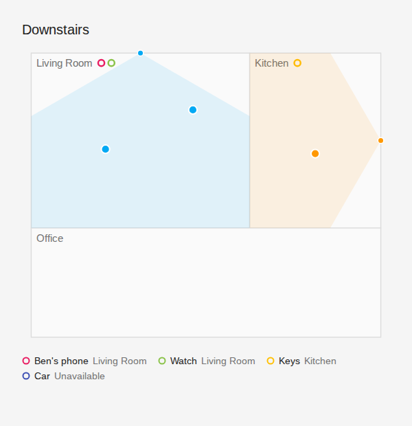

# Presence Map Card

A Home Assistant Lovelace card that draws your areas as boxes on a floor plan and plots live presence-sensor targets on it.



- Pick the Home Assistant **areas** to show and place each one as a box (origin and size).
- Add **presence sensors** to an area at a position and rotation inside it.
- Each detected target is drawn as a dot at **area origin + sensor offset + the target's position (rotated to match the sensor)**.
- Or take the room shapes from **[Map Fusion](https://github.com/cubicecho/map_fusion_ha_integration)**, which traces them from your robot vacuum's map (see [Room shapes from Map Fusion](#room-shapes-from-map-fusion)).
- Optionally list **tracked devices** from [Bermuda BLE Trilateration](https://github.com/agittins/bermuda). Each one shows as a hollow dot beside the name of the area it is in, with a legend under the map.

Only the **HLK-LD2450** mmWave radar (via ESPHome) is supported for x/y targets for now. Bermuda is supported at area level (which room, not where in it). Other sensor types can be added later (see [Roadmap](#roadmap)).

## Installation

### HACS (recommended)

1. In HACS, open the menu (⋮) → **Custom repositories**.
2. Add this repository's URL with category **Dashboard**.
3. Find **Presence Map Card** in HACS, install it, then reload the browser.

HACS adds the resource for you (`/hacsfiles/presence-map-card/presence-map-card.js`).

### Manual

1. Copy `dist/presence-map-card.js` to `<config>/www/presence-map-card.js`.
2. Go to **Settings → Dashboards → ⋮ → Resources** and add `/local/presence-map-card.js` as a **JavaScript module**.
3. Reload the browser.

## Usage

Add the card from the dashboard's **Add card** picker ("Presence Map"). The visual editor lets you:

- choose areas and set each box's `x`, `y`, `width` and `height`,
- add LD2450 sensors to an area, pick the sensor's device, and set its position and rotation.

Picking a device fills in its target entities automatically.

### YAML example

```yaml
type: custom:presence-map-card
title: Downstairs
hide_outside_area: true
show_fov: true
areas:
  - area: living_room
    x: 0
    y: 0
    width: 5
    height: 4
    sensors:
      - type: ld2450
        device: 0123456789abcdef0123456789abcdef   # optional, enables auto-discovery
        name: Living radar
        x: 2.5          # middle of the top wall
        y: 0
        rotation: 0     # facing down the map, into the room
        targets:        # optional when `device` is set
          - x: sensor.living_radar_target_1_x
            y: sensor.living_radar_target_1_y
          - x: sensor.living_radar_target_2_x
            y: sensor.living_radar_target_2_y
          - x: sensor.living_radar_target_3_x
            y: sensor.living_radar_target_3_y
  - area: kitchen
    x: 5
    y: 0
    width: 3
    height: 4
    sensors:
      - type: ld2450
        device: fedcba9876543210fedcba9876543210
        x: 3            # right wall
        y: 2
        rotation: 90    # facing left, into the room
```

## Configuration reference

### Card

| Option | Type | Default | Description |
| --- | --- | --- | --- |
| `type` | string | **required** | `custom:presence-map-card` |
| `title` | string | none | Card header |
| `hide_outside_area` | boolean | `true` | Hide targets that fall outside their sensor's area (ghost readings through walls) |
| `show_fov` | boolean | `true` | Draw each sensor's field-of-view wedge |
| `show_legend` | boolean | `true` | Show the tracked-device legend under the map (only when `trackers` is set) |
| `map_fusion` | `true` or object | off | Take area shapes from Map Fusion (see [below](#room-shapes-from-map-fusion)) |
| `areas` | list | `[]` | Areas to draw (see below) |
| `trackers` | list | `[]` | Devices tracked at area level, e.g. Bermuda (see [Tracked devices](#tracked-devices-bermuda)) |

### Area

| Option | Type | Default | Description |
| --- | --- | --- | --- |
| `area` | string | **required** | Home Assistant area id |
| `name` | string | area name | Label override |
| `x`, `y` | number (m) | `0` | Box origin (top-left corner) on the map. With `map_fusion`, only used when Map Fusion has no shape for the area |
| `width`, `height` | number (m) | `4`, `3` | Box extent; must be above 0. Same fallback rule as `x`, `y` |
| `sensors` | list | `[]` | Sensors in this area |

### Sensor

| Option | Type | Default | Description |
| --- | --- | --- | --- |
| `type` | string | `ld2450` | Sensor type. Only `ld2450` today |
| `device` | string | none | Device id. If `targets` is empty, targets are discovered from this device |
| `name` | string | none | Label |
| `x`, `y` | number (m) | `0` | Position **relative to the area's origin** |
| `rotation` | number (°) | `0` | Facing direction, clockwise (see below) |
| `flip_x` | boolean | `false` | Mirror the sensor's lateral axis (for sensors mounted upside down) |
| `color` | string | palette | Dot colour (any CSS colour) |
| `targets` | list | `[]` | Explicit target entities |

### Target

| Option | Type | Description |
| --- | --- | --- |
| `x` | entity id | Entity reporting the target's lateral position |
| `y` | entity id | Entity reporting the target's distance from the sensor |

A target with only one of `x`/`y` set is ignored.

## Room shapes from Map Fusion

[Map Fusion](https://github.com/cubicecho/map_fusion_ha_integration) is a Home Assistant integration that turns robot vacuum maps (Dreame for now) into one map per floor, with each room linked to an HA area. With it, you don't measure rooms by hand: the card draws each room's real outline.

```yaml
type: custom:presence-map-card
map_fusion: true
areas:
  - area: office            # no x/y/width/height: the shape comes from Map Fusion
    sensors:
      - type: ld2450
        device: 0123456789abcdef0123456789abcdef
        x: 2.2              # still measured from the area's top-left corner
        y: 0
```

- Every room on the Map Fusion map is drawn. List an area under `areas` only to add sensors or a label.
- An area's top-left corner is the top-left of its outline's bounding box, so sensors are placed the same way as before.
- `hide_outside_area` checks the real outline (with 10 cm of slack for the gaps vacuums leave at walls and doors), not the box.
- Vacuum rooms not linked to an area are drawn dashed.
- Areas Map Fusion hasn't placed use the card's `x`/`y`/`width`/`height` if you gave them, or are listed under the map as "Not on the map yet". In the editor, **Place on Map Fusion map** saves the card's box to Map Fusion (admins only), so every card and integration uses the same shape.

| Option | Type | Default | Description |
| --- | --- | --- | --- |
| `map_fusion.frame` | string | first map | Which Map Fusion map to show (a floor id, or `vacuum.<name>:<map id>` when your areas have no floors) |
| `map_fusion.all_areas` | boolean | `true` | Draw every Map Fusion room. `false` draws only the areas listed in the card |

`map_fusion: true` is the same as `map_fusion: {}`.

## Coordinate system

- All lengths are **metres**.
- The map's **x** axis points right and its **y** axis points **down** the screen, like a floor plan drawn on paper. An area at `x: 0, y: 0` sits at the top-left.
- A sensor's `x`/`y` are measured from its area's origin, so moving an area moves its sensors with it.
- An LD2450 looks along its own +y axis. `rotation` turns it clockwise:

| `rotation` | Sensor faces | Typical mounting |
| --- | --- | --- |
| `0` | down (+y) | top wall |
| `90` | left (−x) | right wall |
| `180` | up (−y) | bottom wall |
| `270` | right (+x) | left wall |

Any angle works, e.g. `45` for a corner mount.

- `flip_x: true` mirrors the sensor's lateral axis. Use it if dots move left when you walk right.

## LD2450 auto-discovery

The card expects the ESPHome [`ld2450`](https://esphome.io/components/sensor/ld2450.html) component with the per-target X/Y sensors enabled. ESPHome names these entities like `sensor.<node>_target_1_x` / `sensor.<node>_target_1_y`.

When a sensor has a `device` and no `targets`, the card looks through the entities on that device. It picks up every `sensor.*target_N_x` / `sensor.*target_N_y` pair (also `targetN_x` and `..._x_coordinate`), ordered by `N`. Other target sensors (speed, distance, angle, resolution) are ignored.

Values are converted from the entity's `unit_of_measurement` (`mm`, `cm`, `m`, `in`, `ft`; mm if missing). A target reporting `0, 0` is treated as "no target" and hidden.

## Tracked devices (Bermuda)

[Bermuda](https://github.com/agittins/bermuda) works out which area each Bluetooth device (phone, watch, tag) is in. The card can show that alongside the radar targets:

- On the map, each device in an area gets a **hollow dot** (coloured outline, no fill) beside that area's name. The filled dots stay reserved for radar targets, so the two never look alike.
- Under the map, a **legend** lists every device with its dot, its name and the area it is currently in (or *Away* / *Unavailable*).

Devices in an area that is not on the map only appear in the legend.

```yaml
trackers:
  - type: bermuda
    device: 0123456789abcdef0123456789abcdef   # Bermuda device; its Area sensor is found automatically
    name: Ben's phone
    color: "#e91e63"
  - entity: sensor.keys_tag_area               # or point at the Area sensor directly
```

| Option | Type | Default | Description |
| --- | --- | --- | --- |
| `type` | string | `bermuda` | Tracker source. Only `bermuda` exists today |
| `device` | string | none | Bermuda device id. Its `sensor.<device>_area` entity is used |
| `entity` | string | found from `device` | The Bermuda "Area" sensor to read. Overrides discovery |
| `name` | string | device name | Legend label |
| `color` | string | palette | Dot colour (any CSS colour) |

The card reads Bermuda's `sensor.<device>_area` entity. It uses the entity's `area_id` attribute to match the device to a map area, and falls back to matching the state (the area name) against your HA areas for older Bermuda versions. In the visual editor, picking the device fills in the Area sensor for you.

## Calibration tips

1. Measure the room and set the area's `width`/`height` first.
2. Place the sensor where it is physically mounted, measured from the area's top-left corner.
3. Set `rotation` so the field-of-view wedge points into the room.
4. Walk straight away from the sensor. The dot should move along the wedge's centre line. If it moves sideways, adjust `rotation`.
5. Walk left to right in front of it. If the dot moves the opposite way, enable `flip_x`.
6. Turn `hide_outside_area` off temporarily to see readings that land outside the box.

## Roadmap

- More sensor types that report an x/y position. When Bermuda gains real trilateration (x/y), that would become a sensor driver, separate from today's area-level `trackers`. Sensor types are pluggable: each implements the `SensorDriver` interface in [`src/sensors/driver.ts`](src/sensors/driver.ts) and is listed in [`src/sensors/registry.ts`](src/sensors/registry.ts). The map code handles placing whatever points a driver returns.
- Non-rectangular areas without Map Fusion (drawing outlines in the editor).

## Development

```bash
npm install
npm run build      # bundle → dist/presence-map-card.js
npm run dev        # rebuild on change
npm test           # vitest
npm run typecheck  # tsc --noEmit
```

The bundle in `dist/` is committed so HACS installs need no toolchain. Rebuild and commit it whenever `src/` changes. CI fails if it is stale.

## License

MIT
